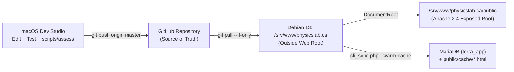

# 🚀 Terra Physics Lab — Stage 4, Git Deployment & Ongoing Revisions Guide

> **Status**: Stage 4 Implementation & Operations Blueprint  
> **Canonical Production Domain**: `https://physicslab.ca`  
> **Target Production Host**: **Debian 13 (Trixie) + Apache 2.4 + PHP 8 (8.4) + MariaDB + Python 3 `.venv` (`sympy`)**  
> **Server Paths**: Repo Root `/srv/www/physicslab.ca` | Apache `DocumentRoot /srv/www/physicslab.ca/public`  
> **Deployment Transport**: **Git-Native (`git clone` $\to$ `git pull --ff-only`)** with Web-Root Directory Isolation  
> **Companion Docs**: [`archive/rollout_fixes.md`](../archive/rollout_fixes.md) (Completed Stages 1–3 Record), [`CLAUDE.md`](../CLAUDE.md), [`docs/architecture.md`](architecture.md)

---

## 1. Architectural Model: Git-Native Ongoing Production

Because **Terra Physics Lab** is an actively evolving platform—continuously receiving equation repairs (`scripts/fixlatex`), multi-step derivations, OPS 2.0 prose upgrades, simulation refinements, and future science manifolds—deployment is designed around **frictionless, repeatable Git deltas** rather than manual tarball or `rsync` packaging.



### 1.1 Why `git clone` + `DocumentRoot /srv/www/physicslab.ca/public` Is Safe
* **Directory Isolation**: The repository is cloned into `/srv/www/physicslab.ca`, while Apache's `DocumentRoot` points strictly to the `/srv/www/physicslab.ca/public` **directory** (never `/srv/www/physicslab.ca` and never the `index.php` file path). Everything one level above `/public`—including `.git/`, `app/config/config.php`, `vendor/`, `lib/`, `tests/`, `docs/`, and `cli_sync.php`—sits outside Apache's web root and cannot be requested over HTTP.
* **Clean State Separation (Git-Owned vs. Server-Owned)**:
  * **Git-Owned (Updated by `git pull`)**: PHP application code, JS/CSS assets, views, `256` hex formula shards, `13` subtopic shards, `hub_manifests/`, `composer.json`, and `requirements.txt`.
  * **Server-Owned (Ignored by Git via [`.gitignore`](../.gitignore), Never Overwritten by `git pull`)**:
    1. `app/config/config.php` — production credentials, `'app_env' => 'production'`, and `'app_url'`.
    2. `vendor/` — Composer `--no-dev` autoloader and runtime packages.
    3. `.venv/` — PEP 668 isolated Python environment (`sympy`, `mpmath`).
    4. `app/config/*_embeddings.json.gz` — precomputed dense vector indexes (`99 MB` total, copied once via `scp`).
    5. `app/log/` & `public/cache/` — runtime logs, compiled HTML cache, `sitemap.xml`, and `embeddings_query_cache.json`.
    6. Operational MariaDB tables (`users`, `formula_reviews`, `formula_audit_logs`) — `cli_sync.php` only synchronizes encyclopedia content (`topics`, `subtopics`, `simulations`, `formulas`) and never wipes operational tables.

---

## 2. One-Time Debian 13 Server Provisioning Runbook

### 2.1 System Packages & Apache Modules
```bash
sudo apt update
sudo apt install -y \
    apache2 mariadb-server git unzip curl \
    php php-cli php-mysql php-mbstring php-xml php-curl \
    composer python3-venv

# Enable required Apache modules for routing, security headers, caching, and gzip compression
sudo a2enmod rewrite headers expires deflate
```

### 2.2 MariaDB Least-Privilege Database & Tuning
Replace default `root` database usage in [`app/config/config_sample.php`](../app/config/config_sample.php) with a dedicated `terra_app` account scoped strictly to `terra.*`:
```sql
CREATE DATABASE IF NOT EXISTS terra
  CHARACTER SET utf8mb4 COLLATE utf8mb4_unicode_ci;

CREATE USER IF NOT EXISTS 'terra_app'@'localhost'
  IDENTIFIED BY 'CHANGE_ME_STRONG_RANDOM_PASSWORD';

GRANT SELECT, INSERT, UPDATE, DELETE, CREATE, ALTER, INDEX
  ON terra.* TO 'terra_app'@'localhost';

FLUSH PRIVILEGES;
```
Recommended `/etc/mysql/mariadb.conf.d/99-terra-tuning.cnf` (`innodb_buffer_pool_size = 256M`) keeps all `14,684` formulas and `1,584` subtopics resident in RAM.

### 2.3 Initial Repository Clone & `.gitignore`d Bootstrap
```bash
# 1. Clone repository into /srv/www/physicslab.ca (owned by your deploy user, group www-data)
sudo mkdir -p /srv/www/physicslab.ca
sudo chown "$USER":www-data /srv/www/physicslab.ca
git clone https://github.com/jholobetz/terra.git /srv/www/physicslab.ca
cd /srv/www/physicslab.ca

# 2. Grant www-data write access ONLY to runtime log and cache directories (setgid 2775)
mkdir -p app/log public/cache
sudo chgrp -R www-data app/log public/cache
chmod 2775 app/log public/cache

# 3. Install PHP production dependencies (excludes dev-only packages)
composer install --no-dev --optimize-autoloader --no-interaction

# 4. Create Debian PEP 668 Python .venv for the local SymPy CAS engine
python3 -m venv .venv
.venv/bin/pip install --upgrade pip
.venv/bin/pip install -r requirements.txt

# 5. Create server-local app/config/config.php
cp app/config/config_sample.php app/config/config.php
chmod 640 app/config/config.php
sudo chgrp www-data app/config/config.php
# Edit app/config/config.php:
#   'app_env' => 'production',
#   'app_url' => 'https://physicslab.ca',
#   'database' => ['host' => 'localhost', 'dbname' => 'terra', 'user' => 'terra_app', 'password' => '...']

# 6. (Optional, one-time from macOS Studio) Copy .gitignored compressed vector embeddings (99 MB)
# scp app/config/physics_embeddings.json.gz app/config/subtopic_embeddings.json.gz user@physicslab.ca:/srv/www/physicslab.ca/app/config/

# 7. Sync MariaDB, run RBAC/review table migration, and warm all 1,596 HTML caches + sitemap.xml
APP_ENV=production php scripts/migrations/001_create_rbac_and_review_tables.php
APP_ENV=production php cli_sync.php --force-cache
sudo chown -R "$USER":www-data public/cache app/log
sudo chmod -R g+rwX public/cache app/log
```

### 2.4 Updating Existing Apache + Let's Encrypt VirtualHost Configuration
Because `physicslab.ca` already has Apache and Let's Encrypt TLS provisioned via Certbot, **do not overwrite** your existing Certbot `SSLCertificateFile` / `SSLCertificateKeyFile` / `options-ssl-apache.conf` directives. Instead, update your existing active `:443` SSL config (`/etc/apache2/sites-available/physicslab.ca-le-ssl.conf`, and `:80` `physicslab.ca.conf` if `DocumentRoot` is listed there) so `DocumentRoot` and `<Directory>` point to `/srv/www/physicslab.ca/public`:

```apache
<IfModule mod_ssl.c>
<VirtualHost *:443>
    ServerName physicslab.ca
    ServerAlias www.physicslab.ca
    DocumentRoot /srv/www/physicslab.ca/public

    SetEnv APP_ENV production

    <Directory /srv/www/physicslab.ca/public>
        Options -Indexes +FollowSymLinks
        AllowOverride All
        Require all granted
    </Directory>

    ErrorLog ${APACHE_LOG_DIR}/physicslab_error.log
    CustomLog ${APACHE_LOG_DIR}/physicslab_access.log combined

    # Keep your existing Certbot / Let's Encrypt directives intact:
    # Include /etc/letsencrypt/options-ssl-apache.conf
    # SSLCertificateFile /etc/letsencrypt/live/physicslab.ca/fullchain.pem
    # SSLCertificateKeyFile /etc/letsencrypt/live/physicslab.ca/privkey.pem
</VirtualHost>
</IfModule>
```
*(Validate and apply changes without dropping connections via `sudo apache2ctl configtest && sudo systemctl reload apache2`. With HTTPS already active, [`SecurityHeadersMiddleware.php`](../app/middlewares/SecurityHeadersMiddleware.php) HSTS headers and `'app_url' => 'https://physicslab.ca'` work immediately out of the box.)*

---

## 3. Stage 4 Engineering Tasks (Code & Ongoing-Revision Hardening)

To ensure that **every future `git pull`** updates browsers, disk caches, MariaDB schemas, and PHP workers cleanly without stale artifacts, Stage 4 implements the following concrete items:

### 3.1 JavaScript `?v=filemtime` Cache-Busting & Subtopic Formula Cache Invalidation
1. **Versioned `<script>` URLs in [`app/views/physics/layout.php`](../app/views/physics/layout.php) & Views**:
   * Currently CSS `<link>` tags append `?v=filemtime(...)`, while `<script src="/js/...">` tags do not. Adding `?v=filemtime(...)` to JS `<script>` tags ensures browsers bust cached JS immediately after any `git pull`, making 1-year `.htaccess` asset caching completely safe across revisions.
2. **Formula-Aware `isCacheStale()` in [`app/controllers/PhysicsController.php`](../app/controllers/PhysicsController.php)**:
   * Extend `isCacheStale()` to check [`app/views/physics/_equations_partial.php`](../app/views/physics/_equations_partial.php), `public/css/physics.css`, and the hex formula shards (`app/config/content/formulas/[xx]/shard_[xx].json`) referenced by each subtopic's `formula_ids`.
   * **Impact**: Whenever `scripts/fixlatex` repairs an equation or adds a multi-step derivation, incremental `php cli_sync.php --warm-cache` automatically detects and rebuilds every affected subtopic HTML cache file.

### 3.2 Tracked Database Migration Runner (`schema_migrations`)
* Add an idempotent `schema_migrations` ledger table and migration runner invoked automatically by [`cli_sync.php`](../cli_sync.php) (and `cli_sync.php --migrate`):
  * Scans `scripts/migrations/*.php` in lexical order (`001_...`, `002_...`).
  * Executes only unapplied migrations and records their filename + timestamp in `schema_migrations`.
  * Ensures future OPS 2.0, Chemistry/Math manifold, or curator workflow tables deploy automatically on `git pull`.

### 3.3 [`public/.htaccess`](../public/.htaccess) Compression & Static Cache Policy
* **Gzip Compression (`mod_deflate`)**: Enable `AddOutputFilterByType DEFLATE` for `text/html`, `text/plain`, `text/css`, `text/xml`, `application/xml`, `application/javascript`, `text/javascript`, `application/json`, and `image/svg+xml` (shrinking `tex-svg-full.js` from `2.2 MB` to `~520 KB` and `math.min.js` from `690 KB` to `~170 KB`).
* **Long-Lived Static Asset Caching**: Configure `Expires` + `Cache-Control: public, max-age=31536000` on versioned `.css`, `.js`, `.svg`, `.woff2`, `.png`, and `.webp` assets while keeping HTML and JSON responses dynamically revalidated.
* **ACME-Safe Dotfile Protection**: Block direct HTTP requests to hidden files (`^\.`) while **explicitly exempting `/.well-known/`** (`RewriteCond %{REQUEST_URI} !^/\.well-known/`) so Certbot's automatic 60-day Let's Encrypt HTTP-01 renewals (`/.well-known/acme-challenge/`) never receive a `403 Forbidden`.
* **Server Config Templates**: Commit reference templates under `deploy/apache/physicslab.ca-le-ssl.conf.example`, `deploy/mariadb/provision_terra.sql`, and `deploy/mariadb/99-terra-tuning.cnf`.

### 3.4 Automated Git Update & Rollback Script (`scripts/update_prod.sh`)
Provide a single, idempotent server update script (`bash scripts/update_prod.sh`) supporting three operational modes:
1. **Standard Update (`bash scripts/update_prod.sh`)**:
   * Records pre-update `HEAD` SHA for instant recovery if needed.
   * Runs `git fetch origin master` and compares changed paths (`git diff --name-only HEAD..origin/master`).
   * Executes `git pull --ff-only origin master`.
   * Runs `composer install --no-dev --optimize-autoloader` **only** if `composer.json` / `composer.lock` changed.
   * Runs `.venv/bin/pip install -r requirements.txt` **only** if `requirements.txt` changed.
   * Runs `APP_ENV=production php cli_sync.php --warm-cache` (applies any new numbered migrations, delta-syncs modified shards to MariaDB, incrementally warms stale HTML caches, and updates `sitemap.xml`) while preserving `www-data` group write permissions (`2775`) on `public/cache/` and `app/log/`.
   * Reloads PHP-FPM / Apache gracefully (`opcache` refresh, zero dropped requests) if any `.php` or `.htaccess` file changed.
   * Verifies `https://physicslab.ca/healthz` via local TLS loopback (`curl -fsSL --resolve physicslab.ca:443:127.0.0.1 https://physicslab.ca/healthz`) returns `200 OK` (`"status":"ok"`), testing the live `:443` Let's Encrypt VirtualHost directly rather than hitting port `80`'s `301` redirect.
2. **Fast Content/Equation Push (`bash scripts/update_prod.sh --quick`)**:
   * Pulls latest Git commits and runs `APP_ENV=production php cli_sync.php --warm-cache` directly (`~2–5s` end-to-end for routine `fixlatex` repairs or subtopic prose updates).
3. **One-Command Rollback (`bash scripts/update_prod.sh --rollback [ref]`)**:
   * Checks out the specified commit/tag (defaulting to the recorded pre-deploy `HEAD`), re-runs `cli_sync.php --warm-cache`, reloads PHP/Apache, and verifies `/healthz`.

---

## 4. Ongoing Revision Cheat-Sheet (Day-to-Day Workflow)

| Revision Type (on macOS Studio) | Local Verification | Deploy Command on Debian 13 | What Happens on Server |
| :--- | :--- | :--- | :--- |
| **Equation Repair (`scripts/fixlatex`) or New Proof** | `composer test` + `git push` | `bash scripts/update_prod.sh --quick` | Pulls shard diff $\to$ upserts only changed hex shards $\to$ rebuilds only subtopics using those formulas (`~3s`). |
| **New / Edited OPS Subtopic Prose (`gqs.py`)** | `scripts/assess -q` + `git push` | `bash scripts/update_prod.sh --quick` | Pulls prose shard $\to$ upserts modified subtopics $\to$ warms new HTML + `sitemap.xml` (`~4s`). |
| **Frontend JS / CSS / Simulation Update** | `composer test` + `pytest` + `git push` | `bash scripts/update_prod.sh` | Pulls assets $\to$ `filemtime` bumps `?v=` query strings automatically $\to$ refreshes affected HTML caches. |
| **Backend PHP / Route / Database Schema Change** | `scripts/assess` + `git push` | `bash scripts/update_prod.sh` | Pulls PHP & `scripts/migrations/` $\to$ runs new migrations once $\to$ warms caches $\to$ graceful Apache/PHP OPcache reload $\to$ checks `/healthz`. |
| **Emergency Rollback** | — | `bash scripts/update_prod.sh --rollback` | Restores previous commit $\to$ resyncs shards/caches $\to$ reloads OPcache $\to$ checks `/healthz`. |

---

## 5. Server-Side `agy` CLI Usage & Split-Brain Guardrails

Running the **Antigravity CLI (`agy`)** directly inside `/srv/www/physicslab.ca` on Debian 13 is fully supported: [`CLAUDE.md`](../CLAUDE.md) (`GEMINI.md` / `AGENTS.md`), `.agents/rules/`, and `.agents/skills/` (`mariadb-shard-sync`, `cas-symbolic-prover`, `lineage-graph-healer`, `ops-prose-auditor`) use portable repository-relative paths, and `.antigravitycli/` + `scratch/` are already listed in [`.gitignore`](../.gitignore).

### 5.1 High-Value Server-Side Use Cases
1. **Live Server Provisioning & Log Triage**: Inspect `/var/log/apache2/physicslab_error.log`, `app/log/`, `apache2ctl -S`, MariaDB `terra_app` privileges, `www-data` file permissions, and `https://physicslab.ca/healthz` directly on the host without copying logs between machines.
2. **Database & Cache Drift Diagnostics**: Run `scripts/assess -q` or invoke `mariadb-shard-sync` to verify shard-to-MariaDB parity and cache freshness in place. *(Note: if you want full `pytest` and offline maintenance tooling available to `agy` on Debian 13 as well, install [`requirements-dev.txt`](../requirements-dev.txt) instead of minimal [`requirements.txt`](../requirements.txt) inside `/srv/www/physicslab.ca/.venv`.)*
3. **Emergency Remote Hotfixes**: Apply urgent equation repairs (`scripts/fixlatex "<formula-id>"`) + `APP_ENV=production php cli_sync.php --warm-cache` over SSH when away from the macOS Studio workstation.

### 5.2 The Git Split-Brain Guardrail (`git pull --ff-only`)
Because [`scripts/update_prod.sh`](#34-automated-git-update--rollback-script-scriptsupdate_prodsh) uses `git pull --ff-only origin master`, leaving uncommitted edits or unpushed commits on `/srv/www/physicslab.ca` will cause future pulls to halt cleanly rather than silently overwriting work:
* **Default Operating Discipline**: Treat **macOS Studio** as the primary authoring environment and use **`agy` on Debian 13** primarily for **read-only diagnostics, server operations, and deployment verification** (keeping `git status` clean on `/srv/www/physicslab.ca`).
* **When Hotfixing on the Server**: Always finish any server-side edit by committing and pushing back to GitHub immediately (`git commit && git push origin master`), then `git pull --ff-only` on macOS Studio before starting your next authoring session so GitHub remains the single linear source of truth.

