# 🔭 Terra Physics Lab — Strategic Remediation & Development Roadmap

> **Status**: Active Master Roadmap  
> **Target Horizon**: 2026–2027  
> **Authoritative References**: [`CLAUDE.md`](../CLAUDE.md), [`README.md`](../README.md), [`docs/architecture.md`](architecture.md), [`archive/horizons_and_expansion.md`](../archive/horizons_and_expansion.md)

---

## 1. Executive Baseline & Platform Health

Over successive engineering sprints, the **Terra Physics Lab** platform has attained a mature, publication-grade foundation:

| Metric / Dimension | Benchmark Status | Verification Gate |
| :--- | :--- | :--- |
| **Subtopic Coverage** | **1,584 / 1,584 Subtopics (100.0%)** graduated to Organic Platinum Standard (OPS) | `integrity_shield.py` (OPS Lead & Density Audit) |
| **Formula Catalog** | **14,684 Physical Formulas** across 256 hex shards (`00` to `ff`) | `integrity_shield.py` (Shard Hex Partition Audit) |
| **Derivation Lineage DAG** | **Lineage Health Index (LHI) of 99.9 / 100** with **0 isolated nodes** (14,119 edges) | `scripts/fixlineage --summary` |
| **Manifold Closure** | **100.0% equation closure** (0 unmapped prose identities across 8,649 expressions) | `php scripts/audit_prose_equations.php` |
| **Symbolic CAS Engine** | Sandboxed SymPy worker ([`cas_engine.py`](../lib/cas/cas_engine.py)) with async `/physics/api/cas-evaluate` | `pytest tests/test_cas_engine.py` |
| **Modular ES6 Client** | `equation_explainer.js` decoupled into `simulations`, `curator`, `dictionary` modules | Browser verification & regression suite |
| **Production Deployment** | **Live on [`https://physicslab.ca`](https://physicslab.ca)** (Debian 13, Apache 2.4, PHP 8.4, MariaDB, Let's Encrypt TLS) | `/healthz` & `scripts/update_prod.sh` |
| **Regression Net** | **100% passing automated test suite** (241+ Pytest tests + 30 native PHP unit suites covering all 14,684 formulas) | `.venv/bin/python3 -m pytest tests/` & `composer test` |

---

## 2. Phased Architectural Roadmap

```mermaid
flowchart TD
    subgraph Phase1["Phase 1: Stabilization & Hardening (Completed)"]
        P1A["100% OPS Prose Graduation"]
        P1B["LHI Derivation Healing (99.9 / 100, 0 Isolated)"]
        P1C["Modularize equation_explainer.js"]
        P1D["Centralized Delimiter Standardization"]
    end

    subgraph Phase2["Phase 2: Codebase Hygiene & Interactivity (Completed)"]
        P2A["Purge & Archive scratch/ & scripts/"]
        P2B["Step-by-Step Derivation Accordions"]
        P2C["Modular Canvas/WebGL Visualizer Library"]
        P2D["Multi-Step Derivation Proof Seeding (104 Proofs)"]
    end

    subgraph Phase3["Phase 3: Formal Verification & Unified Ingestion (Completed)"]
        P3A["Database-wide SymPy CAS Proof Sweep (9,302 Verified)"]
        P3B["Autonomous Agent Sweeps under Budget Contracts"]
        P3C["Unified 5-Stage Formula Ingestion Pipeline"]
    end

    subgraph Phase4["Phase 4: Production Hardening & Cutover (Completed)"]
        P4A["4.1 Security & --no-dev Hardening"]
        P4B["4.2 Debian 13 Packaging, /healthz & Cache Warmer"]
        P4C["4.3 Branded Error Views, CSP Hygiene & SEO/Sitemap"]
        P4D["4.4 Apache/MariaDB Provisioning & Git Deploy Pipeline"]
    end

    subgraph Phase5["Phase 5: Next Horizon (Undetermined)"]
        P5A["5.1 Undetermined at This Time"]
    end

    subgraph Phase6["Phase 6: OPS 2.0 Upgrade"]
        P6A["6.1 OPS 2.0 Qualitative Rubric & Referee Panel"]
    end

    subgraph Phase7["Phase 7: Project Terra Expansion (Flagship Scale)"]
        P7A["7.1 Chemistry Lab Manifold"]
        P7B["Mathematics Lab Manifold"]
        P7C["Cross-Domain Scientific Ontology"]
    end

    Phase1 --> Phase2
    Phase2 --> Phase3
    Phase3 --> Phase4
    Phase4 --> Phase5
    Phase5 --> Phase6
    Phase6 --> Phase7
```



---

## 3. Phase 1: Stabilization & Hardening (Completed Achievements)

### 1.1 Modularization of the Client Monolith
* **Accomplished**: Successfully deconstructed the 5,376-line `equation_explainer.js` into focused ES6 modules:
  - `explainer_simulations.js`: HTML5 Canvas 2D vector field visualizations (divergence, curl, wave propagation) and Web Audio sonification.
  - `explainer_curator.js`: Curator Drawer UI, peer-review suggestions, and parameter edit staging.
  - `explainer_dictionary.js`: Symbol, variable, and unit mappings.
  - Retained core AST parsing and MathJax rendering in `equation_explainer.js` without regressions.

### 1.2 Mathematical Derivation Lineage DAG (LHI 95.2)
* **Accomplished**: Healed isolated formula nodes from early baselines down to **0 isolated nodes**, achieving an LHI score of **95.2 / 100** across all 14,614 formulas. Compiled acyclic DAG structures (`formula_derivation_graph.json` and `.gz`).

### 1.3 100% Organic Platinum Standard (OPS) Completion
* **Accomplished**: All 1,584 subtopic articles graduated to the Organic Platinum Standard, satisfying strict In Media Res physical openings, zero-artifact continuous HTML prose, and rich inline MathJax density.

### 1.4 Centralized Delimiter & Math Sanitization Standard
* **Accomplished**: Unified delimiter handling in `PhysicsService.php`, `scripts.lib.delimiters`, and `math_prose_formatter.js`.

---

## 4. Phase 2: Codebase Hygiene & Interactivity (Completed Achievements)

### 2.1 Codebase Hygiene & Repository Streamlining
* **Goal**: Eliminate stale historical artifacts and obsolete scratch files to reduce repository noise.
* **Actions**:
  1. Archive one-off historical migrations and superseded documentation into the root `archive/` directory.
  2. Deprecate superseded maintenance scripts in `scripts/maintenance/` into `scripts/archive/` (or `archive/`), retaining canonical tools (`fixlatex`, `fixlineage`, `gqs.py`, `integrity_shield.py`).
  3. Ensure clean `.gitignore` tracking for temporary debug files.

### 2.2 Step-by-Step Derivation Accordions
* **Goal**: Transform single-link parent-child relationships ($A \to B$) into readable, collapsible multi-step mathematical derivations.
* **Accomplished**:
  1. Expanded `app/config/formula.schema.json` with `derivation_steps` schema (step, latex, rationale) and `derivation_type`.
  2. Implemented persistence, JSON decoding, and MariaDB synchronization in `PhysicsService.php` and `FormulaReviewService.php`.
  3. Integrated collapsible derivation accordions with MathJax typesetting into the Equation Explainer (`equation_explainer.php` / `public/js/equation_explainer.js`), the in-page Formula Inspector modal (`public/js/formula_inspector.js`), and the Curator slide-over drawer (`public/js/explainer_curator.js`).
  4. Seeded canonical foundation formulas (Euler-Lagrange equations, Time-Dependent & Time-Independent Schrödinger equations, Klein-Gordon massive field, Poisson observable dynamics, Lorentz force law, Quantum probability continuity, Relativistic energy-momentum invariant, Schwarzschild metric) across Git shards with rigorous step-by-step mathematical proofs (expanded to 53 canonical formulas).
  5. Added comprehensive test coverage in `tests/test_derivation_steps.py` (verifying all 53 proofs, schema compliance, and TeX brace/delimiter integrity).

### 2.3 Modular Canvas / WebGL Visualizer Library & Simulation Elevations
* **Goal**: Enrich theoretical physics topics with interactive, parameter-tunable visual models.
* **Accomplished**:
  1. Built the zero-dependency `WebGLPhysicsHarness` (`public/js/lib/webgl_physics_harness.js`) supporting WebGL2/GLSL 300 es, shader compilation with formatted error logs, automatic uniform binding, HiDPI scaling, smooth spherical orbit camera with inertia, and ping-pong FBOs.
  2. Implemented Flagship Option A: **Relativistic Kerr Black Hole Raytracer** (`public/js/simulations/relativistic-black-hole.js`):
     - Real-time GPU null geodesic raymarching in Boyer-Lindquist coordinates for static Schwarzschild ($a=0$) and spinning Kerr ($a \le 0.998$) black holes.
     - Physically accurate event horizon shadows ($r_+$), Cauchy inner horizons ($r_-$), ergosphere frame-dragging ($r_{\text{ergo}}$), and ISCO ($r_{\text{isco}}$).
     - Relativistic Keplerian accretion disk with Shakura-Sunyaev / Novikov-Thorne temperature profiles, gravitational redshift, and Doppler beaming ($I_{\text{obs}} = g^4 I_{\text{emit}}$).
     - Procedural celestial starfield gravitational lensing and Einstein rings.
     - Presets: Interstellar (Gargantua), M87* (EHT), Static Schwarzschild, Extreme Kerr, Polar Jet Axis, Pure Star Lensing.
     - Real-time mathematical telemetry HUD and 4K PNG snapshot export.
  3. **Elevated Academic Simulations** (`commit bf08034a`):
     - *Damped-Driven Chaotic Pendulum & Poincaré Sections* (`public/js/simulations/pendulum.js`): 4th-order Runge-Kutta (RK4) integration of $d^2\theta/dt^2 + \gamma d\theta/dt + \omega_0^2 \sin(\theta) = F_0 \cos(\omega_d t)$, real-time phase portrait $(\theta, \dot{\theta})$, Feigenbaum period-doubling cascade, and stroboscopic Poincaré recurrence attractor.
     - *Newton's Orbital Cannon & Escape Trajectories* (`public/js/simulations/projectile-motion.js`): Simulates Newton's 1728 spherical planet thought experiment with continuous transitions from sub-orbital arcs to circular orbital insertion ($7.91\text{ km/s}$), bound Keplerian ellipses ($9.6\text{ km/s}$), and hyperbolic cosmic escape ($11.19\text{ km/s}$).
  4. Registered simulations in MariaDB, `app/config/content/simulations.json`, `_topic_icons.php`, and embedded direct GPU launcher inside Equation Explainer.
  5. Automated regression test net verified in `tests/test_webgl_simulations.py`.

### 2.4 Hero Stage Cosmic Arena & Unified Cockpit
* **Status**: Completed (`commit 8ee1a836`).
* **Accomplished**:
  1. Built the 60fps high-DPI canvas engine (`public/js/cosmic_arena.js`) on the `/physics/lab-tools` landing page across 4 physical regimes:
     - *The Butterfly of Chaos*: Double pendulum RK4 integration and phase space trajectory.
     - *The Quantum Ghost*: 1D Schrödinger Gaussian wave packet tunneling and barrier penetration.
     - *Tuning the Universe to Death*: Relativistic ISCO orbital collapse in Schwarzschild spacetime.
     - *The Breaking of Energy*: Noether time-symmetry perturbation with dynamic $\partial \mathcal{L} / \partial t \neq 0$ breaking energy conservation.
  2. Integrated Web Audio API harmonic sound synthesis (`playTone`) modulated by system frequencies.
  3. Deployed color-coupled mathematical telemetry HUD ($q$ cyan, $p$ emerald, $V$ amber, $E$ purple) and interactive "What-If?" micro-challenges.
  4. Embedded the 6-system Crucible and 5-mode Transformation Prism (Variational, Noether, Quantum, Rosetta, Dimensions) into `app/views/physics/lab_tools.php`.

### 2.5 Cross-Encyclopedia Lab Tools Ingestion & URL State Hydration
* **Status**: Completed.
* **Accomplished**:
  1. Built `app/logic/LabToolsLauncher.php` with curated mapping rules covering all 1,584 subtopic articles to their optimal interactive lab instrument, duality workbench, or numerical simulation with pre-hydrated URL parameters.
  2. Implemented deep-linking URL state hydration across all 5 flagship lab tools (`legendre_transformer.js`, `noethers_vault.js`, `correspondence_workspace.js`, `anthropic_tuner.js`, `notation_toggle.js`) and the Unified Cockpit (`lab_cockpit.js`).
  3. Embedded interactive header action launchers (`.lab-launcher-badge`) and ambient in-prose cockpit bridge cards (`.subtopic-cockpit-bridge`) directly into `subtopic.php`.
  4. Verified cache-invalidation architecture in `PhysicsController.php` with 9/9 automated tests in `tests/test_lab_tools_hydration.py`.

### 2.6 Analytical Mechanics Workbench Deepening (Legendre Transformer)
* **Status**: Completed.
* **Accomplished**:
  1. Expanded the physical preset library from 6 to **10 publication-grade classical & relativistic configurations**:
     - *Harmonic Oscillator* (1D quadratic potential)
     - *Simple Pendulum* (transcendental gravitational potential)
     - *Anharmonic Duffing Oscillator* (quartic restoring force $\beta q^4 / 4$)
     - *Relativistic Free Particle* (square root kinetic metric $-mc^2\sqrt{1-v^2/c^2}$)
     - *Charged Particle in EM Field* (magnetic vector potential gauge shift $q\mathbf{A}\cdot\mathbf{v}$)
     - *Rotating Reference Frame* (non-diagonal Coriolis cross-coupling $m\omega(x\dot{y}-y\dot{x})$ and centrifugal potential)
     - *2D Central Force* (polar coordinates $(r, \phi)$ with cyclic conservation)
     - *Kepler Two-Body Gravitational Problem* (reduced mass $\mu$, cyclic $\phi$, conserved $p_\phi$)
     - *3D Spherical Central Force* (metric tensor $W_{ij}$, $\det(W) = m^3 r^4 \sin^2\theta$, cyclic $\phi$)
     - *Singular Constrained System* (degenerate $\det(W) = 0$ triggering Dirac primary constraint analysis)
  2. Enhanced SymPy CAS engine ([`lib/cas/cas_engine.py`](../lib/cas/cas_engine.py)) to cleanly format coupled multi-variable inverted velocity fields ($\dot{q}_i = \dots$) across arbitrary configuration dimensions.
  3. Added responsive 2-column preset selectors to [`app/views/physics/legendre_transformer.php`](../app/views/physics/legendre_transformer.php) and state pre-loading in [`public/js/legendre_transformer.js`](../public/js/legendre_transformer.js).
  4. Mapped celestial mechanics and rotational dynamics subtopics (`keplers-second-law`, `rotational-dynamics`, `coupled-oscillations`, `central-force`) directly into dedicated presets in [`LabToolsLauncher.php`](../app/logic/LabToolsLauncher.php).

### 2.7 Derivation Steps Proof Seeding & Universal Domain Parity
* **Status**: Completed (`commit 9adced2e`).
* **Accomplished**:
  1. Expanded multi-step mathematical proofs across all 256 formula shards from 53 to **103 verified proofs**.
  2. Established Universal Domain Parity ($\ge 8$ proofs in all 12 physics pillar domains): Astrophysics (9), Classical Mechanics (9), Condensed Matter (9), Electromagnetism (9), Fluid Dynamics (8), General Relativity (9), Nuclear Physics (8), Optics (8), Particle Physics (9), Plasma Physics (8), Quantum Mechanics (9), and Thermodynamics (9).
  3. Validated 100% schema compliance, TeX brace balance, and narrative delimiter purity across all 103 proofs in `tests/test_derivation_steps.py`.
  4. Verified full Git shard and MariaDB synchronization in `formulas_hash_registry.json` (0 drift).

### 2.8 Thin Shard Curriculum Enrichment (`fluids-nonlinear.json`)
* **Status**: ⏸️ **Deferred (Next-Level Curriculum Horizon)**.
* **Architectural Rationale**:
  - The encyclopedia currently maintains **100.0% manifold closure** across all 1,584 subtopics with 0 broken links and 0 orphaned nodes.
  - Subtopic expansion is intentionally deferred to a future curriculum expansion phase to preserve 100% topological and mathematical closure across the existing 1,584-article manifold.

---

## 5. Phase 3: Formal Verification & Unified Ingestion Architecture (Completed)

### 3.1 Database-wide SymPy CAS Proof Sweep (Batch Campaign)
* **Goal**: Upgrade derivation links and formula identities from pedagogical references to **algebraically proven identities** and catalog verified badges across the encyclopedia.
* **Current Status**:
  * **Option A (Engine & Lexicon Expansion)**: 🟢 **Completed** (`commit 6aee2609`). Added CGS, astrophysics, particle physics, natural units ($\hbar=c=k_B=1$), and subscript/prefix heuristics.
  * **Option B (Batch Shard Tagging & DB Sync)**: 🟢 **Completed**. Audited all **14,681 formulas** (`11,943` equations, `2,738` symbols/terms) across the 256 Git shards, certifying and tagging **9,302 homogeneous physical invariants (63.4% overall / 77.9% of equations)** with `cas_validation` metadata, updating `cas_validation_report.json` and `formulas_hash_registry.json` with 0 drift, and enabling Dual-Layer Resilience hydration in `PhysicsService::loadFormula()`.
  * **Option C (Multi-Step Derivation & Lineage DAG Prover)**: 🟢 **Completed**. Audited all **103 multi-step derivation proofs** (`scripts/cascheck --derivations`), certifying **103 complete proof chains (100.0%)** with **103 / 103 terminal equation matches**.

### 3.2 Unified 5-Stage Formula Ingestion Pipeline
* **Goal**: Unify formula ingestion and subtopic graduation under a single, airtight quality gate. Eliminates "tier-2 / unanchored" formulas and guarantees that every formula entering the system—whether via terminal CLI or the Web UI "Auto-Draft" button—is bidirectionally wired into the DAG, verified by CAS, and bridged into encyclopedia subtopics.
* **The 5-Stage Ingestion Pipeline (`lib/pipeline/formula_pipeline.py`)**:
  ```
  [1. Draft Formula]       ──► Synthesizes definition, symmetry, limits, variables
          │
          ▼
  [2. Bidirectional DAG]   ──► Links child -> parent AND parent -> child (reciprocity)
          │
          ▼
  [3. CAS Unit Prover]     ──► Proves dimensional homogeneity (SymPy SI + Natural Units)
          │
          ▼
  [4. Dual-Layer Sync]     ──► Writes hex shard, updates hash registry & MariaDB
          │
          ▼
  [5. Subtopic Bridge]     ──► Maps formula to relevant encyclopedia subtopic
  ```
* **Accomplished**:
  1. **Stage 1 (Core Pipeline Engine)**: Built and unit-tested `lib/pipeline/formula_pipeline.py` implementing the 5 atomic steps with transactional rollback.
  2. **Stage 2 (Dual Wiring)**: Connected `/physics/api/define-formula` (the Web UI "Auto-Draft" button) and `gqs.py` formula commands to this shared engine.

### 3.3 Autonomous Governance & Safeguards
* **Goal**: Enforce deterministic token bounding and pre-flight budget firewalls per [`docs/cost_governance.md`](cost_governance.md) across all generative scripts.

---

## 6. Phase 4: Production Hardening & `physicslab.ca` Cutover (Completed)

> **Rollout Blueprints Archive**: [`archive/rollout_fixes.md`](../archive/rollout_fixes.md) (Stages 1–3), [`archive/final_stages.md`](../archive/final_stages.md) (Stage 4 & Cutover) & [`archive/post_cutover.md`](../archive/post_cutover.md) (8/8 Burn-In Verification)

### 4.1 Security & `--no-dev` Production Hardening
* **Status**: Completed (`commit 198f3a3b1`).
* **Accomplished**:
  1. Restricted `?preview=1` shard overrides and developer studio privileges via `AuthService::isLocalDevStudio()` so public visitors in `APP_ENV=production` cannot bypass cached MariaDB reads.
  2. Enforced `Debugger::Production` error isolation and `class_exists()` Composer `--no-dev` guards across [`app/config/services.php`](../app/config/services.php) and [`SecurityHeadersMiddleware.php`](../app/middlewares/SecurityHeadersMiddleware.php) so `tracy/tracy` and `runway` are cleanly omitted on production hosts.
  3. Implemented spoof-resistant client IP resolution (`AuthService::resolveClientIp()`), per-IP semantic search rate limiting, a zero-external-API production firewall in [`SemanticSearchService.php`](../app/logic/SemanticSearchService.php), `dev_mock` seed skipping in production RBAC migrations, and atomic `0775` / `LOCK_EX` disk cache writes.

### 4.2 Debian 13 Packaging, `/healthz` Probe & CLI Cache Warmer
* **Status**: Completed (`commit 198f3a3b1`).
* **Accomplished**:
  1. Standardized multi-SAPI `APP_ENV` resolution (`getenv()`, `$_SERVER['APP_ENV']`, `$_SERVER['REDIRECT_APP_ENV']`, and `config.php` `'app_env'`) across Apache `mod_php`/`php-fpm` and CLI maintenance runners.
  2. Split minimal runtime Python dependencies ([`requirements.txt`](../requirements.txt): `sympy==1.14.0`, `mpmath==1.3.0`) from development/test tooling ([`requirements-dev.txt`](../requirements-dev.txt)) for clean Debian 13 Python 3.13 `.venv` provisioning.
  3. Added zero-leak `/healthz` and `/physics/healthz` endpoints verifying MariaDB connectivity, writable cache storage, and sandboxed SymPy CAS execution (`HTTP 200` vs `503`).
  4. Eliminated `GET`-time database upserts in production and built in-process `PhysicsController::warmHtmlCache()` + `php scripts/cli_sync.php --warm-cache` (`1,596` hub and subtopic HTML pages pre-rendered in `< 1s`).

### 4.3 Branded Error Views, CSP Hygiene & Search Discovery
* **Status**: Completed (`commit 3bffa5b6d`).
* **Accomplished**:
  1. Created branded [`error_404.php`](../app/views/physics/error_404.php) and [`error_500.php`](../app/views/physics/error_500.php) templates mapped via `$app->map('notFound', ...)` and `$app->map('error', ...)` with zero stack-trace leakage.
  2. Replaced legacy inline `onmouseover`/`onmouseout`/`onclick` attributes across encyclopedia templates with strict CSP-compliant CSS `:hover` rules and delegated event listeners, and removed the public footer admin link outside local studio mode.
  3. Added Host-header-safe canonical URL resolution (`$config['app_url']`), dynamic `<meta name="description">`, `<link rel="canonical">`, OpenGraph metadata, [`public/favicon.svg`](../public/favicon.svg), `/robots.txt` (`Disallow: /physics/admin`, `Disallow: /physics/api/`), and cached `/sitemap.xml` (`1,600+` canonical URLs via `cli_sync.php --sitemap`).

### 4.4 Apache/MariaDB Provisioning, Revision Safeguards & Live Cutover
* **Status**: Completed & Live on [`https://physicslab.ca`](https://physicslab.ca) (`commits 74caaf5ca`, `fcdea6991`, `866289200`).
* **Accomplished**:
  1. Provisioned `/srv/www/terra` on **Debian 13 (Trixie)** with Apache 2.4 (`DocumentRoot /srv/www/terra/public`, keeping `.git/`, `app/`, `vendor/`, `lib/`, and `tests/` outside the web root), Let's Encrypt TLS (`:443`), PHP 8.4, MariaDB, and `sympy` `.venv`, codified in [`deploy/apache/physicslab.ca-le-ssl.conf.example`](../deploy/apache/physicslab.ca-le-ssl.conf.example), [`deploy/mariadb/provision_terra.sql`](../deploy/mariadb/provision_terra.sql), and [`deploy/mariadb/99-terra-tuning.cnf`](../deploy/mariadb/99-terra-tuning.cnf).
  2. Hardened [`public/.htaccess`](../public/.htaccess) with `mod_deflate` compression, 1-year `immutable` static asset caching paired with `?v=filemtime` script query strings, and ACME-safe dotfile blocking (`!^/\.well-known/`).
  3. Extended `PhysicsController::isCacheStale()` to track shared layout CSS/JS and memoized hex formula shard `mtime`s, added DB-backed `schema_migrations` and `shard_sync_state` tables in [`ShardSyncService.php`](../app/logic/ShardSyncService.php) so production `cli_sync.php` never dirties Git-tracked files, and added first-boot empty-schema table provisioning.
  4. Built and verified [`scripts/update_prod.sh`](../scripts/update_prod.sh) (`--quick`, `--rollback`, `--dry-run`, automatic `:443` `/healthz` verification) on the live server, backed by **14 new PHP test suites** (`Stage1`–`Stage4`, bringing `composer test` to **30 suites / 1,317 assertions**).

---

## 7. Phase 5: Physics Lab Curriculum Completion & Curatorial Polish (Completed)

> **Running Expansion Ledger**: [`docs/new_expansion_phase_5.md`](new_expansion_phase_5.md)

Rather than chasing arbitrary topic quotas, **Phase 5** fleshed out Physics Lab into a complete, publication-grade digital physics encyclopedia (`1,584 → 1,659` Platinum subtopics, `+505` canonical formulas to `15,203` total, `0` undefined clicks, `$0.00` external API cost) before Phase 6 (OPS 2.0) and Phase 7 (Multi-Science Expansion):

* **5.1 Hub Gateway Curation (Completed)**: Surfaced existing hidden Platinum articles on sparse Hub Gateway roadmaps (`thermodynamics-statistical-mechanics` `14 → 36`, `quantum-physics` `27 → 35` before Wave A expansion).
* **5.2 Substance-First Curriculum Completion (`750–1,000` stripped words, `0` undefined clicks — Completed)**:
  * **Foundation Batches 1–6 (`+30` subtopics, `+191` formulas)**: Deepened thin hubs (`fluids-nonlinear` `20 → 30`, `condensed-matter` `24 → 34`, `mathematical-methods` `28 → 38`) and built the round-trip transactional compiler [`scripts/expand_hub.py`](../scripts/expand_hub.py) (`--context`, `--export-slugs`, `--update-existing`, `750` word floor, `1,000` soft ceiling, Zero-Undefined-Click audit).
  * **Wave A — Foundational Core Gaps (Batches 7–10, `+20` subtopics, `+139` formulas)**: Classical Thermodynamics & Phase Equilibria (`+5`), Nonequilibrium Statistical Mechanics (`+5`), Atomic Physics, Spin & Quantum Scattering (`+5`), Open Quantum Systems, Quantum Optics & Quantum Information (`+5`).
  * **Wave B — Modern Frontiers & Cross-Science Bridges (Batches 11–15, `+25` subtopics, `+175` formulas)**: 2D Quantum Materials, Spintronics & Topological Matter (`+5`), Pattern Formation, Solitons & Active Matter (`+5`), Continuum Elasticity, Integrable Tori & Hamiltonian Chaos (`+5`), Topology, Spinors & Computational Physics (`+5`), Applied Optics, Lasers & Plasma Physics (`+5`).
* **5.3 Post-Launch Hygiene & Audit Closure (Completed)**: Resolved `58 / 58` findings from [`archive/post_launch_eval-2026-11-19.md`](../archive/post_launch_eval-2026-11-19.md).

---

## 8. Phase 6: OPS 2.0 Upgrade (6.1)

* **6.1 OPS 2.0 Qualitative & Linguistic Architecture**: Qualitative 5-point rubric evaluation, deterministic discourse linting (`gqs.py lint`), and multi-agent referee critique (`gqs.py critique`) as specified in [`docs/OPS 2.0 (The Qualitative Rubric).md`](OPS%202.0%20(The%20Qualitative%20Rubric).md).

---

## 9. Phase 7: Project Terra Multi-Science Expansion (7.1)

Physics Lab serves as the flagship domain module for **Project Terra**. With the core architecture (FlightPHP microframework, 256-shard partitioning, dual-engine math rendering, and automated integrity shields) proven at scale:

* **Chemistry Lab**: Molecular manifolds, reaction kinetics, orbital hybridization, and thermochemical cycles.
* **Mathematics Lab**: Abstract algebra, differential geometry, topology, and number theory derivations.
* **Biology & Earth Sciences**: Cellular biophysics, population dynamics, geophysics, and atmospheric fluid dynamics.

---

## 10. Master Priority & Implementation Ledger

| Horizon | ID | Initiative | Key Components / Files | Priority | Status |
| :--- | :--- | :--- | :--- | :---: | :---: |
| **Phase 1** | 1.1 | Modularize `equation_explainer.js` | `public/js/explainer_simulations.js`<br/>`public/js/explainer_curator.js` | 🔴 **P1** | 🟢 Completed |
| **Phase 1** | 1.2 | Derivation Lineage DAG Healing (LHI 99.9) | `scripts/fixlineage`<br/>`formula_derivation_graph.json` | 🔴 **P1** | 🟢 Completed |
| **Phase 1** | 1.3 | 100% OPS Subtopic Graduation | `app/config/content/*.json`<br/>`integrity_shield.py` | 🔴 **P1** | 🟢 Completed |
| **Phase 2** | 2.1 | Scratch & Maintenance Script Archival | `scratch/`<br/>`archive/README.md` | 🟡 **P2** | 🟢 Completed |
| **Phase 2** | 2.2 | Step-by-Step Derivation Infrastructure | `equation_explainer.php`<br/>`shard_[00-ff].json` | 🟡 **P2** | 🟢 Completed |
| **Phase 2** | 2.3 | WebGL Raytracer & Simulation Elevations | `relativistic-black-hole.js`<br/>`pendulum.js`<br/>`projectile-motion.js` | 🟡 **P2** | 🟢 Completed |
| **Phase 2** | 2.4 | Hero Stage Cosmic Arena & Cockpit | `cosmic_arena.js`<br/>`lab_cockpit.js`<br/>`lab_tools.php` | 🟡 **P2** | 🟢 Completed |
| **Phase 2** | 2.5 | Cross-Encyclopedia Lab Tools Ingestion | `LabToolsLauncher.php`<br/>`subtopic.php`<br/>`test_lab_tools_hydration.py` | 🟡 **P2** | 🟢 Completed |
| **Phase 2** | 2.6 | Analytical Mechanics Workbench Deepening | `legendre_transformer.js`<br/>`legendre_transformer.php`<br/>`cas_engine.py` | 🟡 **P2** | 🟢 Completed |
| **Phase 2** | 2.7 | Derivation Steps Proof Seeding | `shard_[00-ff].json`<br/>`tests/test_derivation_steps.py` | 🟡 **P2** | 🟢 Completed (104 Proofs) |
| **Phase 2** | 2.8 | Thin Shard Curriculum Enrichment | `fluids-nonlinear.json`<br/>`gqs.py` | 🟢 **P3** | ⏸️ Deferred (Next-Level) |
| **Phase 3** | 3.1 | Database-wide SymPy CAS Proof Sweep | `cas_engine.py`<br/>`batch_cas_prover.py` | 🔴 **P1** | 🟢 Completed (9,302 Tagged) |
| **Phase 3** | 3.2 | Unified 5-Stage Ingestion Pipeline | `lib/pipeline/formula_pipeline.py`<br/>`gqs.py`<br/>`generate_gemini_formula.py` | 🔴 **P1** | 🟢 Completed |
| **Phase 3** | 3.3 | Autonomous Governance Safeguards | `docs/cost_governance.md`<br/>`.agents/skills/` | 🟢 **P3** | 🟢 Guarded |
| **Phase 4** | 4.1 | Security & `--no-dev` Hardening | `AuthService.php`<br/>`SemanticSearchService.php`<br/>`services.php` | 🔴 **P1** | 🟢 Completed |
| **Phase 4** | 4.2 | Debian 13 Packaging, `/healthz` & Cache Warmer | `requirements.txt`<br/>`PhysicsController.php`<br/>`cli_sync.php` | 🔴 **P1** | 🟢 Completed |
| **Phase 4** | 4.3 | Branded Error Views, CSP Hygiene & SEO/Sitemap | `error_404.php`<br/>`error_500.php`<br/>`layout.php` | 🔴 **P1** | 🟢 Completed |
| **Phase 4** | 4.4 | Apache/MariaDB Provisioning & Git Deploy Pipeline | `public/.htaccess`<br/>`ShardSyncService.php`<br/>`scripts/update_prod.sh` | 🔴 **P1** | 🟢 Completed (Live on `physicslab.ca`) |
| **Phase 5** | 5.1–5.3 | Physics Lab Curriculum Completion & Curatorial Polish | `scripts/expand_hub.py`<br/>`docs/new_expansion_phase_5.md`<br/>`hub_manifests/*.json` | 🔴 **P1** | 🟢 Completed (Batches 1–24, +120 Subtopics) |
| **Phase 6** | 6.1 | OPS 2.0 Upgrade | `docs/OPS 2.0 (The Qualitative Rubric).md`<br/>`gqs.py` | 🟡 **P2** | 📋 Planned |
| **Phase 7** | 7.1 | Project Terra Multi-Science Expansion | Chemistry, Mathematics, Earth Sciences | 🟢 **P3** | 🔭 Strategic |
